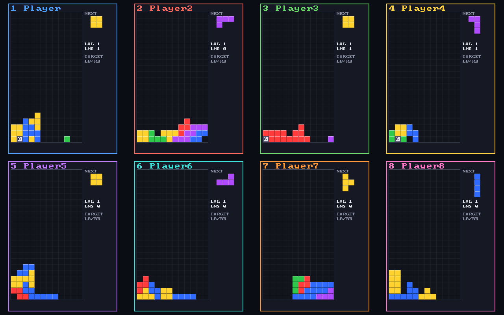

# gtetrinet-ng

A modern continuation of [GTetrinet](https://gitlab.gnome.org/Archive/gtetrinet), the GPL
TetriNET client. Play falling-block battles locally, on a LAN, or connect to a TetriNET
server. The main goal is eight controllers sharing one Steam Deck screen.

**0.1.2 is an early preview.** Eight client connections and scripted matches are tested;
physical eight-controller Deck play and independent online-server interoperability are
still awaiting verification. Classic servers/clients generally support six players.



## Install

Download from [Releases](https://github.com/jarvis-jhk/gtetrinet-ng/releases).
Linux x86_64: extract the archive and run `./gtetrinet-ng.sh`. SDL2 is bundled; the host
supplies graphics/audio libraries (SteamOS, Mint or Ubuntu 22.04+). Python 3 and curl are
required by the installer/launcher. Windows x86_64: extract the ZIP, run `Play.cmd`;
`gtetrinet-ng.exe` also works directly, without launcher fault reporting.

Steam Deck: switch to Desktop Mode and download `Install-GTetrinet-NG.desktop` from the
release. Open it (confirm “Execute”/“Trust” if your desktop asks) and follow the install
dialogs. Fully exit Steam when prompted, so its shortcut can be safely added or renamed.
The friendly library title is **GTetrinet NG — TetriNET**, with original game artwork.
Alternatively run `bash install.sh`. It installs under `~/.local/share/gtetrinet-ng`, creates
a desktop shortcut and adds a Steam shortcut when Steam's userdata is found. Restart
Steam and return to Game Mode. Use the normal Gamepad template (Steam Input's keyboard
emulation consumes the Deck as a keyboard player). Extra controllers press A to join.
The Linux launcher checks for updates at startup; offline/failure keeps the current version.
Set `GTN_AUTO_UPDATE=0` to disable checks, `GTN_NO_REPORT=1` to disable anonymous reports.
Uninstall: remove that install directory and desktop/Steam shortcuts manually.

## Play

Press Enter (keyboard) or A (controller) to join. Select Local game; other devices can
join before the match starts. A/Start starts it. Each seat gets an independent nickname
and board. Controllers: d-pad/stick moves, Down soft-drops, Up hard-drops, A rotates clockwise / B counterclockwise,
X uses a special on the selected target, Y uses it on yourself, shoulders select targets,
Back discards a special, Start pauses, Back+Start ends the game. A disconnected seat can
be reclaimed by pressing A on an unclaimed controller. Eight fields are a dense layout.

Keyboard: arrows move/rotate, Space drops, X rotates clockwise / Z counterclockwise, S uses a special, Q/E or Tab
changes target, 1–8 uses it on a numbered player, D discards, P pauses. Online entry has
a controller keyboard. Choose TetriFast with Y. `--nick Name` sets your nickname.

On the title screen, controller X or keyboard S opens Options, even before joining.
Up/Down picks a row; Left/Right or A changes it, Y restores its default and
B/Esc/Start returns. Both choices are saved; a failed save shows a warning and keeps
the choice for the current run.

- **Movement repeat** cycles Normal (170 ms delay, 50 ms interval), Relaxed
  (250/100 ms) and Fast (120/30 ms) for held Left/Right on every local
  keyboard/controller. Missing or invalid preferences keep Normal. Soft drop and
  rotation keep their own behavior.
- **Language / Sprache**: Automatic (the system's preferred language), English or
  Deutsch. The German UI covers menus, hints, special names and effect labels,
  status/error messages and the game's own lobby/attack messages. Changelog entries,
  chat, server messages, team names and operating-system error texts stay as written.
  `--lang de|en|auto` overrides it for one run without saving.

Special tiles keep their classic letters and show their effect on the **recipient**:
green `+HELP` (C clear line, N nuke field, G gravity), red `-HURT` (A add line),
amber `?MIX` (R random clear, S switch fields, B clear specials, Q quake, O bomb).
The next queued special has a symbol and category word below the inventory, so color
is not the only cue. Very small field/queue tiles cannot fit a letter; the next-special
label still identifies it. Under TARGET, `+You`/`-You` or `+Them`/`-Them` describes
the selected recipient; `?MIX` means inspect their field, and `?Both` means a swap
changes both players' fields (`?Self` when aimed at yourself).

Helping yourself or a teammate usually helps your side; helping an opponent helps
them. Adding a line hurts the chosen recipient, even yourself. Random clears can
open holes; clearing specials prevents collecting them but can also remove bombs;
quakes shift rows, and bombs scatter nearby cells. Swaps trade the sender's and
target's fields with the classic six-row safety rule. These categories are guidance,
not a guarantee of a win or loss. X/S sends to the selected target (automatically
selecting a live player if necessary); Y always uses the next special on yourself.
Aim with the shoulders/Q/E before sending. Colors never change targeting or the
classic wire protocol.

LAN server: `bin/gtetrinet-ng-server --port 31457 --slots 6` (Windows: server EXE).
Our local game hosts on 31457, or a free port if busy. Firewall/router configuration is
your responsibility. Only use eight slots with clients that support our extension.
No public-server hardening guarantee is made for this preview.

## Build

CMake 3.16+, a C11 compiler and SDL2 2.0.14+ development headers. On Debian/Ubuntu install
`cmake build-essential libsdl2-dev`; on Windows use MSYS2 UCRT64 + GCC/CMake/SDL2.

```
cmake -S . -B build -DCMAKE_BUILD_TYPE=Debug
cmake --build build --parallel 2
ctest --test-dir build --output-on-failure
./build/gtetrinet-ng --window
```

For server/core-only builds use `-DGTN_BUILD_GAME=OFF`. Demo/smoke capture:
`./build/gtetrinet-ng --window --demo 8 --frames 600 --screenshot demo.bmp`.
These are real TCP bot matches, not hardware-input tests.

## Maintenance, privacy and licence

JARVIS maintains this fork; roadmap goals are in [ROADMAP.md](ROADMAP.md), current
validation/limitations in [NOTES.md](NOTES.md). Report problems via GitHub issues.
Launcher failures send only an anonymous version/platform/exit-code report through
ntfy.sh into a GitHub issue. No logs or user/device details are uploaded; topic messages
and issues are public. Release binaries also post a one-line anonymous fault; source builds post nothing unless
configured with `-DGTN_FAULT_REPORTS=ON`. `GTN_NO_REPORT=1` disables all reporting.

GPL-2.0-or-later; see COPYING. Full upstream history, GTK2 source and translations are
preserved in legacy/. Original GTetrinet authors retain their attribution. The active
frontend uses the public-domain font8x8 glyphs (third_party/font8x8_basic.h).
